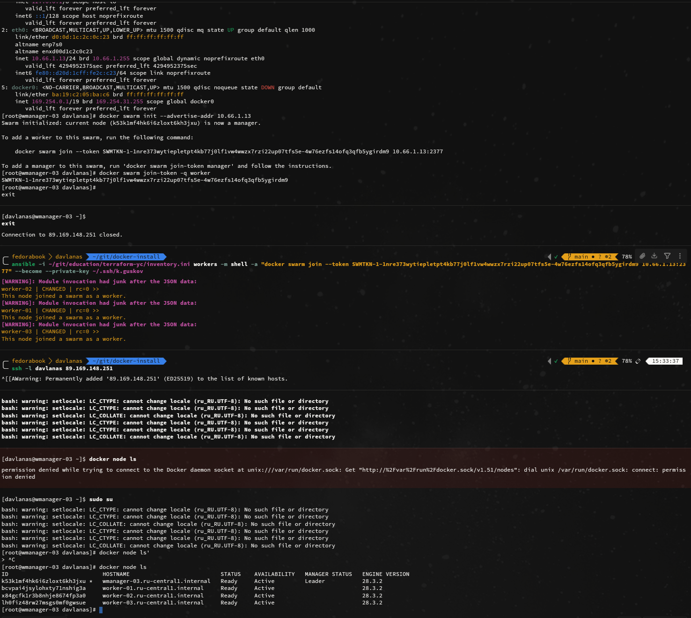

### Установка docker и docker compose на ноды
Не привожу сюда сам ансибл, т.к там роль для установки докера и в ней хватает того, чем я делиться не готов. 
Вот просто сам вывод по установке на воркеры. Аналогичный вывод к менеджеру не прилагаю не вижу смысла.
```
ansible-playbook -i ~/git/education/terraform-yc/inventory.ini -l workers --private-key ~/.ssh/k.guskov docker-install.yml

PLAY [Install docker] *************************************************************************************************************************************************************************************

TASK [Gathering Facts] ************************************************************************************************************************************************************************************
[WARNING]: Module invocation had junk after the JSON data: 
ok: [worker-03]
[WARNING]: Module invocation had junk after the JSON data: 
ok: [worker-01]
[WARNING]: Module invocation had junk after the JSON data: 
ok: [worker-02]

TASK [docker : Include check tasks] ***********************************************************************************************************************************************************************
included: /home/davlanas/git/docker-install/roles/docker/tasks/check_tarball.yml for worker-01, worker-02, worker-03

TASK [docker : Install python3-apt for debian distros] ****************************************************************************************************************************************************
skipping: [worker-01]
skipping: [worker-02]
skipping: [worker-03]

TASK [docker : Gather the package facts] ******************************************************************************************************************************************************************
[WARNING]: Module invocation had junk after the JSON data: 
ok: [worker-01]
[WARNING]: Module invocation had junk after the JSON data: 
ok: [worker-03]
[WARNING]: Module invocation had junk after the JSON data: 
ok: [worker-02]

TASK [docker : Check any docker package is installed] *****************************************************************************************************************************************************
ok: [worker-01] => {
    "changed": false,
    "msg": "All assertions passed"
}
ok: [worker-02] => {
    "changed": false,
    "msg": "All assertions passed"
}
ok: [worker-03] => {
    "changed": false,
    "msg": "All assertions passed"
}

TASK [docker : Install Docker using tarball] **************************************************************************************************************************************************************
included: /home/davlanas/git/docker-install/roles/docker/tasks/install_tarball_linux.yml for worker-01, worker-02, worker-03

TASK [docker : Download docker static binaries] ***********************************************************************************************************************************************************
ok: [worker-01 -> localhost]

TASK [docker : Create a directory for docker if it does not exist] ****************************************************************************************************************************************
[WARNING]: Module invocation had junk after the JSON data: 
ok: [worker-01]
[WARNING]: Module invocation had junk after the JSON data: 
ok: [worker-03]
[WARNING]: Module invocation had junk after the JSON data: 
ok: [worker-02]

TASK [docker : Check installed version] *******************************************************************************************************************************************************************
[WARNING]: Module invocation had junk after the JSON data: 
ok: [worker-02]
[WARNING]: Module invocation had junk after the JSON data: 
ok: [worker-01]
[WARNING]: Module invocation had junk after the JSON data: 
ok: [worker-03]

TASK [docker : Read /opt/docker/INSTALLED.VERSION file] ***************************************************************************************************************************************************
[WARNING]: Module invocation had junk after the JSON data: 
ok: [worker-01]
[WARNING]: Module invocation had junk after the JSON data: 
ok: [worker-02]
[WARNING]: Module invocation had junk after the JSON data: 
ok: [worker-03]

TASK [docker : Installing docker binaries] ****************************************************************************************************************************************************************
skipping: [worker-01]
skipping: [worker-02]
skipping: [worker-03]

TASK [docker : Save /opt/docker/INSTALLED.VERSION file] ***************************************************************************************************************************************************
skipping: [worker-01]
skipping: [worker-02]
skipping: [worker-03]

TASK [docker : Create a /etc/containerd directory if it does not exist] ***********************************************************************************************************************************
[WARNING]: Module invocation had junk after the JSON data: 
ok: [worker-01]
[WARNING]: Module invocation had junk after the JSON data: 
ok: [worker-02]
[WARNING]: Module invocation had junk after the JSON data: 
ok: [worker-03]

TASK [docker : Create /etc/containerd/config.toml file] ***************************************************************************************************************************************************
[WARNING]: Module invocation had junk after the JSON data: 
[WARNING]: Module invocation had junk after the JSON data: 
ok: [worker-02]
[WARNING]: Module invocation had junk after the JSON data: 
[WARNING]: Module invocation had junk after the JSON data: 
ok: [worker-01]
[WARNING]: Module invocation had junk after the JSON data: 
[WARNING]: Module invocation had junk after the JSON data: 
ok: [worker-03]

TASK [docker : Create containerd systemd service unit] ****************************************************************************************************************************************************
[WARNING]: Module invocation had junk after the JSON data: 
[WARNING]: Module invocation had junk after the JSON data: 
ok: [worker-01]
[WARNING]: Module invocation had junk after the JSON data: 
[WARNING]: Module invocation had junk after the JSON data: 
ok: [worker-02]
[WARNING]: Module invocation had junk after the JSON data: 
[WARNING]: Module invocation had junk after the JSON data: 
ok: [worker-03]

TASK [docker : Create docker config files] ****************************************************************************************************************************************************************
[WARNING]: Module invocation had junk after the JSON data: 
[WARNING]: Module invocation had junk after the JSON data: 
ok: [worker-03] => (item=etc/systemd/system/docker.service)
[WARNING]: Module invocation had junk after the JSON data: 
[WARNING]: Module invocation had junk after the JSON data: 
ok: [worker-01] => (item=etc/systemd/system/docker.service)
[WARNING]: Module invocation had junk after the JSON data: 
[WARNING]: Module invocation had junk after the JSON data: 
ok: [worker-02] => (item=etc/systemd/system/docker.service)
[WARNING]: Module invocation had junk after the JSON data: 
[WARNING]: Module invocation had junk after the JSON data: 
ok: [worker-01] => (item=etc/systemd/system/docker.socket)
[WARNING]: Module invocation had junk after the JSON data: 
[WARNING]: Module invocation had junk after the JSON data: 
ok: [worker-03] => (item=etc/systemd/system/docker.socket)
[WARNING]: Module invocation had junk after the JSON data: 
[WARNING]: Module invocation had junk after the JSON data: 
ok: [worker-02] => (item=etc/systemd/system/docker.socket)

TASK [docker : Ensure group "docker" exists] **************************************************************************************************************************************************************
[WARNING]: Module invocation had junk after the JSON data: 
ok: [worker-01]
[WARNING]: Module invocation had junk after the JSON data: 
ok: [worker-03]
[WARNING]: Module invocation had junk after the JSON data: 
ok: [worker-02]

TASK [docker : Ensure executable permissions for tarball binaries] ****************************************************************************************************************************************
[WARNING]: Module invocation had junk after the JSON data: 
ok: [worker-01] => (item=containerd)
[WARNING]: Module invocation had junk after the JSON data: 
ok: [worker-02] => (item=containerd)
[WARNING]: Module invocation had junk after the JSON data: 
ok: [worker-03] => (item=containerd)
[WARNING]: Module invocation had junk after the JSON data: 
ok: [worker-02] => (item=containerd-shim-runc-v2)
[WARNING]: Module invocation had junk after the JSON data: 
ok: [worker-01] => (item=containerd-shim-runc-v2)
[WARNING]: Module invocation had junk after the JSON data: 
ok: [worker-03] => (item=containerd-shim-runc-v2)
[WARNING]: Module invocation had junk after the JSON data: 
ok: [worker-02] => (item=ctr)
[WARNING]: Module invocation had junk after the JSON data: 
ok: [worker-01] => (item=ctr)
[WARNING]: Module invocation had junk after the JSON data: 
ok: [worker-03] => (item=ctr)
[WARNING]: Module invocation had junk after the JSON data: 
ok: [worker-02] => (item=docker)
[WARNING]: Module invocation had junk after the JSON data: 
ok: [worker-01] => (item=docker)
[WARNING]: Module invocation had junk after the JSON data: 
ok: [worker-03] => (item=docker)
[WARNING]: Module invocation had junk after the JSON data: 
ok: [worker-02] => (item=docker-init)
[WARNING]: Module invocation had junk after the JSON data: 
ok: [worker-01] => (item=docker-init)
[WARNING]: Module invocation had junk after the JSON data: 
ok: [worker-03] => (item=docker-init)
[WARNING]: Module invocation had junk after the JSON data: 
ok: [worker-01] => (item=docker-proxy)
[WARNING]: Module invocation had junk after the JSON data: 
ok: [worker-02] => (item=docker-proxy)
[WARNING]: Module invocation had junk after the JSON data: 
ok: [worker-03] => (item=docker-proxy)
[WARNING]: Module invocation had junk after the JSON data: 
ok: [worker-01] => (item=dockerd)
[WARNING]: Module invocation had junk after the JSON data: 
ok: [worker-02] => (item=dockerd)
[WARNING]: Module invocation had junk after the JSON data: 
ok: [worker-03] => (item=dockerd)
[WARNING]: Module invocation had junk after the JSON data: 
ok: [worker-01] => (item=runc)
[WARNING]: Module invocation had junk after the JSON data: 
ok: [worker-02] => (item=runc)
[WARNING]: Module invocation had junk after the JSON data: 
ok: [worker-03] => (item=runc)

TASK [docker : Ensure directroy /etc/bash_completion.d is exists] *****************************************************************************************************************************************
[WARNING]: Module invocation had junk after the JSON data: 
ok: [worker-01]
[WARNING]: Module invocation had junk after the JSON data: 
ok: [worker-03]
[WARNING]: Module invocation had junk after the JSON data: 
ok: [worker-02]

TASK [docker : Ensure alternatives links is exists] *******************************************************************************************************************************************************
[WARNING]: Module invocation had junk after the JSON data: 
ok: [worker-03] => (item=containerd)
[WARNING]: Module invocation had junk after the JSON data: 
ok: [worker-01] => (item=containerd)
[WARNING]: Module invocation had junk after the JSON data: 
ok: [worker-02] => (item=containerd)
[WARNING]: Module invocation had junk after the JSON data: 
ok: [worker-01] => (item=containerd-shim-runc-v2)
[WARNING]: Module invocation had junk after the JSON data: 
ok: [worker-02] => (item=containerd-shim-runc-v2)
[WARNING]: Module invocation had junk after the JSON data: 
ok: [worker-03] => (item=containerd-shim-runc-v2)
[WARNING]: Module invocation had junk after the JSON data: 
ok: [worker-01] => (item=ctr)
[WARNING]: Module invocation had junk after the JSON data: 
ok: [worker-03] => (item=ctr)
[WARNING]: Module invocation had junk after the JSON data: 
ok: [worker-02] => (item=ctr)
[WARNING]: Module invocation had junk after the JSON data: 
ok: [worker-02] => (item=docker)
[WARNING]: Module invocation had junk after the JSON data: 
ok: [worker-03] => (item=docker)
[WARNING]: Module invocation had junk after the JSON data: 
ok: [worker-01] => (item=docker)
[WARNING]: Module invocation had junk after the JSON data: 
ok: [worker-02] => (item=docker-init)
[WARNING]: Module invocation had junk after the JSON data: 
ok: [worker-03] => (item=docker-init)
[WARNING]: Module invocation had junk after the JSON data: 
ok: [worker-01] => (item=docker-init)
[WARNING]: Module invocation had junk after the JSON data: 
ok: [worker-02] => (item=docker-proxy)
[WARNING]: Module invocation had junk after the JSON data: 
ok: [worker-01] => (item=docker-proxy)
[WARNING]: Module invocation had junk after the JSON data: 
ok: [worker-03] => (item=docker-proxy)
[WARNING]: Module invocation had junk after the JSON data: 
ok: [worker-02] => (item=dockerd)
[WARNING]: Module invocation had junk after the JSON data: 
ok: [worker-01] => (item=dockerd)
[WARNING]: Module invocation had junk after the JSON data: 
ok: [worker-03] => (item=dockerd)
[WARNING]: Module invocation had junk after the JSON data: 
ok: [worker-02] => (item=runc)
[WARNING]: Module invocation had junk after the JSON data: 
ok: [worker-01] => (item=runc)
[WARNING]: Module invocation had junk after the JSON data: 
ok: [worker-03] => (item=runc)

TASK [docker : Download docker bash-completion] ***********************************************************************************************************************************************************
ok: [worker-01 -> localhost]

TASK [docker : Copy docker bash-completion from ansible controller] ***************************************************************************************************************************************
[WARNING]: Module invocation had junk after the JSON data: 
[WARNING]: Module invocation had junk after the JSON data: 
ok: [worker-02]
[WARNING]: Module invocation had junk after the JSON data: 
[WARNING]: Module invocation had junk after the JSON data: 
ok: [worker-03]
[WARNING]: Module invocation had junk after the JSON data: 
[WARNING]: Module invocation had junk after the JSON data: 
ok: [worker-01]

TASK [docker : Ensure alternatives links is exists for docker bash-completion] ****************************************************************************************************************************
[WARNING]: Module invocation had junk after the JSON data: 
ok: [worker-01]
[WARNING]: Module invocation had junk after the JSON data: 
ok: [worker-02]
[WARNING]: Module invocation had junk after the JSON data: 
ok: [worker-03]

TASK [docker : Include install tasks for package manager] *************************************************************************************************************************************************
skipping: [worker-01]
skipping: [worker-02]
skipping: [worker-03]

TASK [docker : Install docker-compose] ********************************************************************************************************************************************************************
included: /home/davlanas/git/docker-install/roles/docker/tasks/install_compose.yml for worker-01, worker-02, worker-03

TASK [docker : Install docker-compose required packages] **************************************************************************************************************************************************
[WARNING]: Module invocation had junk after the JSON data: 
ok: [worker-01]
[WARNING]: Module invocation had junk after the JSON data: 
ok: [worker-02]
[WARNING]: Module invocation had junk after the JSON data: 
ok: [worker-03]

TASK [docker : Download docker-compose static binary] *****************************************************************************************************************************************************
ok: [worker-01 -> localhost]

TASK [docker : Create a directory for docker if it does not exist] ****************************************************************************************************************************************
[WARNING]: Module invocation had junk after the JSON data: 
ok: [worker-01]
[WARNING]: Module invocation had junk after the JSON data: 
ok: [worker-02]
[WARNING]: Module invocation had junk after the JSON data: 
ok: [worker-03]

TASK [docker : Check docker-compose installed version] ****************************************************************************************************************************************************
[WARNING]: Module invocation had junk after the JSON data: 
ok: [worker-01]
[WARNING]: Module invocation had junk after the JSON data: 
ok: [worker-02]
[WARNING]: Module invocation had junk after the JSON data: 
ok: [worker-03]

TASK [docker : Read /opt/docker/COMPOSE_INSTALLED.VERSION file] *******************************************************************************************************************************************
[WARNING]: Module invocation had junk after the JSON data: 
ok: [worker-02]
[WARNING]: Module invocation had junk after the JSON data: 
ok: [worker-01]
[WARNING]: Module invocation had junk after the JSON data: 
ok: [worker-03]

TASK [docker : Save /opt/docker/COMPOSE_INSTALLED.VERSION file] *******************************************************************************************************************************************
skipping: [worker-01]
skipping: [worker-02]
skipping: [worker-03]

TASK [docker : Copy docker-compose binary] ****************************************************************************************************************************************************************
skipping: [worker-01]
skipping: [worker-02]
skipping: [worker-03]

TASK [docker : Ensure alternatives links is exists for docker-compose] ************************************************************************************************************************************
[WARNING]: Module invocation had junk after the JSON data: 
ok: [worker-01]
[WARNING]: Module invocation had junk after the JSON data: 
ok: [worker-03]
[WARNING]: Module invocation had junk after the JSON data: 
ok: [worker-02]

TASK [docker : Ensure directory /etc/docker exists] *******************************************************************************************************************************************************
[WARNING]: Module invocation had junk after the JSON data: 
ok: [worker-01]
[WARNING]: Module invocation had junk after the JSON data: 
ok: [worker-03]
[WARNING]: Module invocation had junk after the JSON data: 
ok: [worker-02]

TASK [docker : Configure dockerd] *************************************************************************************************************************************************************************
[WARNING]: Module invocation had junk after the JSON data: 
[WARNING]: Module invocation had junk after the JSON data: 
ok: [worker-01]
[WARNING]: Module invocation had junk after the JSON data: 
[WARNING]: Module invocation had junk after the JSON data: 
ok: [worker-03]
[WARNING]: Module invocation had junk after the JSON data: 
[WARNING]: Module invocation had junk after the JSON data: 
ok: [worker-02]

TASK [docker : Get docker version from socket] ************************************************************************************************************************************************************
[WARNING]: Module invocation had junk after the JSON data: 
ok: [worker-02]
[WARNING]: Module invocation had junk after the JSON data: 
ok: [worker-01]
[WARNING]: Module invocation had junk after the JSON data: 
ok: [worker-03]

TASK [docker : Ensure docker is started and enabled at boot or restart when runtime version mismatch] *****************************************************************************************************
[WARNING]: Module invocation had junk after the JSON data: 
ok: [worker-01]
[WARNING]: Module invocation had junk after the JSON data: 
ok: [worker-03]
[WARNING]: Module invocation had junk after the JSON data: 
ok: [worker-02]

TASK [docker : Add cleanup cron docker images cron job] ***************************************************************************************************************************************************
[WARNING]: Module invocation had junk after the JSON data: 
changed: [worker-03]
[WARNING]: Module invocation had junk after the JSON data: 
changed: [worker-01]
[WARNING]: Module invocation had junk after the JSON data: 
changed: [worker-02]

PLAY RECAP ************************************************************************************************************************************************************************************************
worker-01                  : ok=32   changed=1    unreachable=0    failed=0    skipped=6    rescued=0    ignored=0   
worker-02                  : ok=29   changed=1    unreachable=0    failed=0    skipped=6    rescued=0    ignored=0   
worker-03                  : ok=29   changed=1    unreachable=0    failed=0    skipped=6    rescued=0    ignored=0
```

## Инициализировал кластера на менеджере, а потом просто ансиблом загнал туда ноды, чтобы не бегать по ним и не вводить 3 раза команду



### Terraform.
Приложен проект terraform с динамическим инвентори


### Развертывание сервиса в SWARM
Файл swarm.yaml для развертывания в swarm приложения. 

